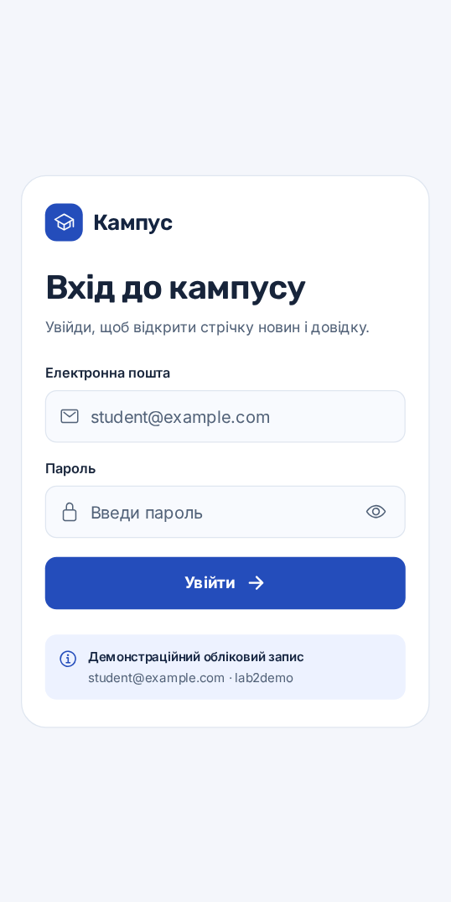
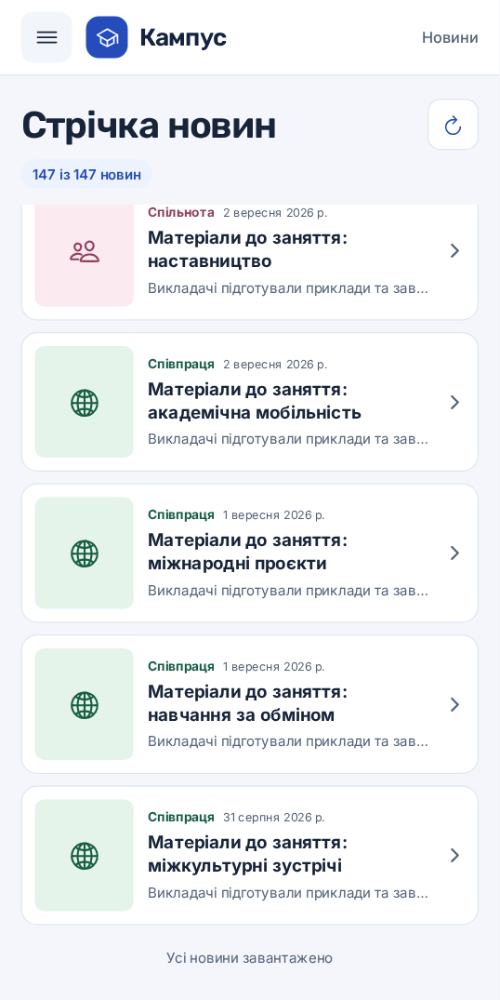
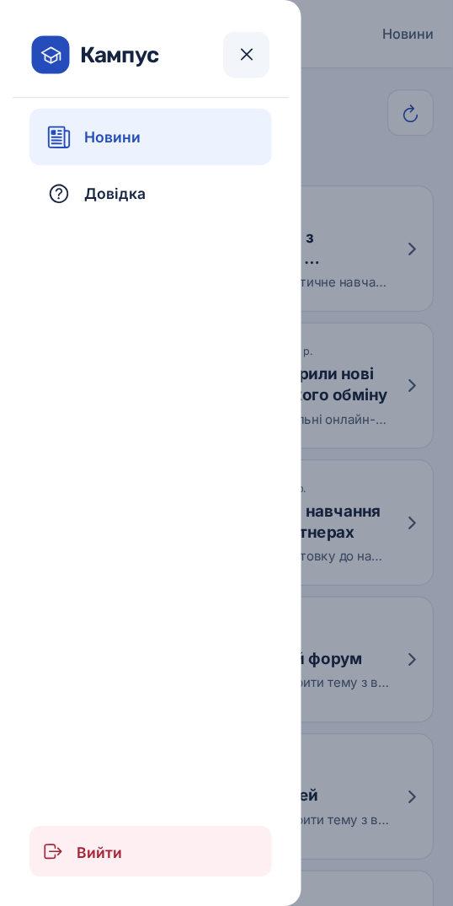

# Лабораторна робота №2

## Тема й мета

Віртуалізація списків та побудова навігації. Мета роботи — навчитися показувати великий набір даних у React Native, вкладати навігатори один в один і керувати доступом до екранів у Expo Router.

## Що я реалізував

Я створив навчальний застосунок «Кампус» на React Native та Expo SDK 58. Після входу користувач бачить стрічку університетських новин. Із бічного меню можна перейти до довідкового центру або завершити сеанс.

- **Вхід.** Створив `AuthProvider` зі станом `isAuthenticated` і функціями `login()` та `logout()`. Форма перевіряє поля й показує повідомлення в разі помилки. Обліковий запис навчальний. Перевірка виконується локально, а стан сеансу зберігається в пам’яті до перезапуску застосунку.
- **Навігація.** Група `(drawer)` захищена через `Redirect`. Усередині Drawer є вкладений Stack для стрічки та деталей. У Stack вимкнув стандартний заголовок, щоб на екрані залишився заголовок Drawer. Для системних відступів використав `react-native-safe-area-context`.
- **Стрічка.** У локальному наборі 147 матеріалів. Спочатку `FlatList` отримує 24 новини. `onEndReached` з порогом `0.45` додає по 24, доки є дані. На телефоні жест Pull-to-Refresh повертає стрічку до першої порції. Кнопка оновлення виконує ту саму дію у вебверсії.
- **Оптимізація.** Картку обгорнув у `React.memo`. Під час підвантаження вже показані картки отримують ті самі об’єкти новин. Висота картки становить 120, а проміжок між картками — 10 логічних пікселів. `getItemLayout` обчислює зміщення за формулою `(120 + 10) * index`.
- **Деталі й довідка.** Картка відкриває динамічний маршрут `/[id]`. Ідентифікатор читається через `useLocalSearchParams`. Для відсутньої новини є повідомлення з переходом до стрічки. Довідка використовує `SectionList` із трьома тематичними розділами та відповідями, які розгортаються після натискання.

## Структура проєкту

| Файл | Призначення |
| --- | --- |
| `app/_layout.jsx` | Кореневий Stack, провайдер авторизації та безпечні відступи |
| `app/login.jsx` | Публічний екран входу |
| `app/(drawer)/_layout.jsx` | Перевірка сеансу, бічне меню та вихід |
| `app/(drawer)/(news)/_layout.jsx` | Вкладений Stack новин |
| `app/(drawer)/(news)/index.jsx` | Віртуалізована стрічка з оновленням і підвантаженням |
| `app/(drawer)/(news)/[id].jsx` | Деталі матеріалу |
| `app/(drawer)/faq.jsx` | Довідковий центр із `SectionList` |
| `src/auth.tsx`, `src/news.ts`, `src/NewsCard.tsx` | Стан сеансу, навчальні новини та картка стрічки |
| `screenshots emu` | Скріншоти застосунку |

## Як запустити у WebStorm

1. Відкрий папку `lab2`, у якій лежить `package.json`.
2. Перевір, що встановлено Node.js 24.3 або новішу версію в гілці 24 LTS.
3. У терміналі WebStorm виконай команди для Windows PowerShell.

   ```powershell
   npm.cmd ci
   npm.cmd run web
   ```

4. Відкрий адресу, яку покаже Expo в терміналі. Для входу використай пошту `student@example.com` і пароль `lab2demo`.

| Команда | Призначення |
| --- | --- |
| `npm.cmd start` | Запустити Metro й отримати QR-код для Expo Go |
| `npm.cmd run android` | Запустити застосунок у вже увімкненому Android-емуляторі |
| `npm.cmd run web` | Відкрити вебверсію |
| `npm.cmd run clear` | Запустити Expo з очищенням кешу Metro |
| `npm.cmd run tunnel` | Запустити тунель для Expo Go, якщо локальне підключення не працює |
| `npm.cmd run typecheck` | Перевірити код TypeScript і JSX |

Для фізичного телефона підключи його й комп’ютер до однієї Wi-Fi мережі, запусти Metro та відкрий QR-код у Expo Go, який підтримує SDK 58. Для Android-емулятора спочатку запусти віртуальний пристрій у Device Manager Android Studio.

Проєкт ініціалізовано через `create-expo-app@latest` із шаблоном `default@sdk-58`. Початкові демонстраційні екрани прибрано через `npm run reset-project` під час підготовки. Додаткові бібліотеки встановлено через `npx expo install`. У готовому проєкті для встановлення залежностей достатньо `npm ci`.

## Скріншоти


| Вхід | Стрічка новин | Деталі новини |
| --- | --- | --- |
|  |  |  |

| Кінець стрічки | Бічне меню | Довідковий центр |
| --- | --- | --- |
|  |  |  |

## Перевірка

У браузері перевірив успішний і невдалий вхід, перенаправлення із захищених адрес, відкриття деталей і повернення до стрічки, підвантаження всіх 147 записів, оновлення списку, перехід до довідки та вихід із сеансу. Перевірив типи та експорт Expo для Web, Android та iOS. Жест Pull-to-Refresh на фізичному телефоні й запуск в Android-емуляторі залишилися для перевірки під час демонстрації.

## Контрольні запитання

1. **Як працює вкладена навігація в Expo Router?** Файл `_layout.jsx` задає навігатор для маршрутів своєї папки. У мене кореневий Stack містить публічний вхід і захищену групу. Drawer перемикає новини й довідку, а Stack усередині новин керує переходом між стрічкою та деталями. Папки в дужках групують маршрути й не додають сегментів до адреси.
2. **Як захистити маршрут від неавторизованого доступу?** У layout групи `(drawer)` я читаю `isAuthenticated` з контексту. Якщо значення хибне, повертаю `<Redirect href="/login" />`. Після успішного входу форма перенаправляє до стрічки. `logout()` скидає стан, тому захищена група знову перенаправляє на вхід. Це захист навігації в навчальному застосунку. Для приватних серверних даних потрібна перевірка прав на сервері.
3. **Чим `FlatList` відрізняється від `ScrollView` і що таке віртуалізація?** `ScrollView` створює всі дочірні елементи. `FlatList` підтримує вікно рендерингу навколо видимої частини списку й поступово додає елементи під час прокрутки. Це зменшує обсяг роботи та використання пам’яті для довгих списків. Віртуалізація керує кількістю елементів інтерфейсу, а пагінація керує кількістю доступних записів.
4. **Як отримати параметр динамічного маршруту?** Ім’я файла `[id].jsx` задає параметр `id`. Посилання передає його в `params`. На цільовому екрані я викликаю `const { id } = useLocalSearchParams()` і шукаю за цим значенням потрібний матеріал.
5. **Які дані приймає `SectionList`?** Властивість `sections` приймає масив об’єктів, кожен із яких містить масив `data`. Я також передаю `key`, `title` та іконку секції. `renderSectionHeader` формує заголовок секції, `renderItem` показує запитання й відповідь, а `keyExtractor` повертає ідентифікатор запитання.

## Висновки

У цій роботі я побудував навігацію з публічним входом, захищеним Drawer і вкладеним Stack. На прикладі 147 новин перевірив, як можна поєднати віртуалізацію з порційним підвантаженням і повторним використанням карток. Також навчився передавати параметри динамічного маршруту та групувати елементи в `SectionList`.

